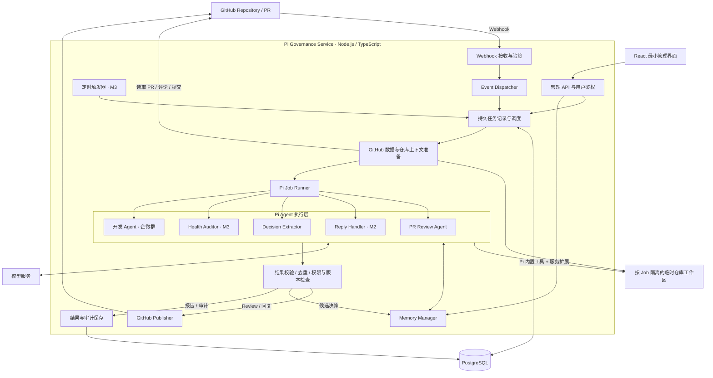

# Pi Repository Governance Agent — Architecture

版本：v0.4｜日期：2026-11-09

> 本文描述系统架构、Agent 分层、工具与副作用边界、输出契约和技术选型。产品范围见 [PRD-MVP.md](./PRD-MVP.md)。

服务沿用一个 Node 进程、PostgreSQL Worker 和固定 SHA Workspace；每个 Agent 任务启动一个 Pi 进程。M2 的独立验收见 [M2](./tasks/M2.md)，M3 的实现与验证见 [M3](./tasks/M3.md)。运行方式的取舍见 [Pi Runtime 决策](../.agents/decisions/pi-runtime.md)，Review 从多 Agent 改为单 Agent + Skills 的理由见 [Review Agent 结构决策](../.agents/decisions/multi-agent-review.md)。

M3 的仓库级任务、报告、调度和持久预算取舍见 [Health Audit 决策](../.agents/decisions/health-audit.md)。

## 1. 架构原则

- Pi 是核心 Agent Framework：服务为每个任务启动一个 Pi 进程，直接使用 Pi 的内置工具、扩展、AGENTS.md 和 Skills。
- 单个 Node.js / TypeScript 服务承载 GitHub 接入、业务规则、预算和 Pi 进程管理。
- GitHub 一级事件由确定性代码路由，不让 LLM 决定事件类型。
- 每类任务一个 Agent，不做多 Agent 委派；专项检查方法写成 Skill。
- 分析类 Agent 没有写文件工具；开发 Agent 只能改临时工作区。GitHub 发布、提交和 Memory 变更统一由服务端执行。
- 当前不引入 Spring Boot、微服务、GraphDB、独立 VectorDB 或复杂工作流平台。

## 2. 系统模块

M0/M1 仅实现对应阶段所需节点；模块数量不等于部署单元数量。

## 3. Agent 与任务

一级路由由代码根据 GitHub 事件和 action 确定，每类任务直接执行对应 Agent：

- PR Review → PR Review Agent。
- PR Merge → Decision Extractor。
- Review Thread Reply → Reply Handler（M2）。
- 定时健康检查 → Health Auditor（M3）。
- 企微群开发需求 → 开发 Agent（见 [开发说明](./wecom-development.md)）。

| 角色 | 输入 | 核心职责 | 结构化输出 | 工具 |
| --- | --- | --- | --- | --- |
| PR Review Agent | PR 快照、源码、历史意见、ACTIVE Memory、目标分支 AGENTS.md | 判断变更影响、审查、按根因分组 | ReviewResult | read / grep / find / ls / bash、codegraph、审查 Skills |
| Reply Handler | App 线程、人类回复、当前代码、原 finding | 验证解释、纠正误判、更新判断 | ReplyResult、决策线索 | 同上，不加载 Skills |
| Decision Extractor | 已合并 PR、最终代码、讨论 | 提取可复用决策、分类、定作用域 | DecisionProposal[] | 同上，不加载 Skills |
| Health Auditor | 固定快照、规则、CI / 测试 / 扫描数据 | 发现仓库层面问题与趋势 | HealthReport | 只有服务端 read_file / search_text（按读过的行核对证据） |
| 开发 Agent | 群需求、图片、团队规则、保护范围、目标分支 AGENTS.md | 修改代码、运行检查 | PR 标题与说明；改动由服务从工作区收集 | 内置工具加 edit / write、codegraph、开发与提交规范 Skills |

Agent 不负责 Webhook 验签、调度、任务持久化、GitHub 权限判断、重试与幂等、Memory 生效和发布。

Repository Curator 仅保留在长期构想，不属于当前实现。

### 3.1 Skill、Tool 与 Agent

- **Skill**：审查或开发方法，放在服务的 [`agent/skills/`](../agent/skills/)，Agent 按任务读取。Review 的 Java、安全、架构、团队规则冲突检查都是 Skill。
- **Tool**：受控的可执行能力。
- **Agent**：承担任务并持有上下文的执行角色。

增加审查方法，不等于必须增加 Agent。M2 曾用 Main + Specialist 多会话审查，成本是单 Agent 的 3–9 倍且专项常失败，已移除；历史任务的编排记录仍可在管理页查看。

## 4. Pi 承载方式

入口是 [`runPiSession`](../src/pi/session.ts)，所有 Agent 调用都经过它：

1. **准备临时配置目录：** 写入模型配置（占位 key、指向本地代理）、关闭重试与上下文压缩的设置、服务 AGENTS.md 和系统提示。
2. **启动本地模型代理：** 每次请求前持久化预留额、收紧输出上限，超预算直接拒绝不转发；转发时换成真实 key。
3. **准备 codegraph：** 有内置工具的 Agent，在工作区没有 `.codegraph/` 时先建索引；失败只是不加载 codegraph 工具。Pi 启动后由服务的 codegraph 扩展启动一个常驻 codegraph 并预热，之后的查询不再重新加载索引；不启动脱离进程组的共享守护进程。
4. **启动 Pi（RPC 模式）：** 工作目录是 Workspace；关闭扩展、Skills、提示模板、主题和上下文文件的自动发现，只加载服务扩展、codegraph 扩展和服务 Skills；环境变量只含运行所需的最小集合。
5. **对话：** 发送任务，等 Pi 结束；调用方需要时在同一会话追加一轮（开发任务补发规则）。
6. **结束：** 正常结束、超时、取消都会结束 Pi 和它启动的命令（同一进程组），结算未回报的预留额，删除临时目录。
7. **保存执行过程：** 删除临时目录前读出 Pi 的会话文件（JSONL），去掉模型思考过程和图片数据、截断过长内容并打码，连同服务记下的耗时（建 codegraph 索引、每次模型请求、每次工具调用）交给调用方存入 `agent_sessions`。运行中有变化时每 5 秒保存一次，管理页能看到进度；结束时再存最终结果。Review、Reply、规则提取、健康检查各存一份；开发任务每次尝试各一份，同一条记录还写入服务完成的步骤（准备工作区、收集改动、检查、创建提交／分支／PR）。管理页的任务详情、系统运行记录和开发任务列表里展开"执行过程"即可按步骤查看，也能下载原始记录。

[服务扩展](../src/pi/extension.ts) 在 Pi 进程里运行，状态留在服务：

- 文件工具的路径按真实路径限制在 Workspace 内，`.git`、`.codegraph` 不可写；
- read、grep、find、ls、bash 的结果先打码疑似凭据；
- 开发任务写入前问服务（保护范围、覆盖前先读、含打码凭据的文件只能局部编辑），读写后由服务附加匹配的团队规则；
- 服务端工具（Health 的 read_file / search_text）转发给服务执行。

注意：独立进程不等于安全沙箱。bash 与服务同一系统用户，环境变量隔离只能避免顺手暴露凭据。

## 5. 规则来源与优先级

从高到低：

1. 服务的安全要求与输出格式：[`agent/AGENTS.md`](../agent/AGENTS.md) 和各任务的系统提示。
2. 团队规则：管理页确认过的 ACTIVE Memory；规则的例外优先于原规则。
3. 仓库 AGENTS.md：服务从目标分支读出、附在系统提示末尾，作为参考。PR 分支上的改动不生效。

仓库的 CLAUDE.md、`.claude/rules`、`.pi` 不加载。

## 6. 工具与副作用边界

| 能力 | 实施方式 | 谁能用 |
| --- | --- | --- |
| read / grep / find / ls | Pi 内置；服务扩展限制路径并打码 | Review / Reply / Decision / 开发 |
| bash | Pi 内置；工作目录是 Workspace，最小环境变量，随进程组结束 | Review / Reply / Decision / 开发 |
| edit / write | Pi 内置；写入前由服务检查 | 仅开发 |
| codegraph_* | 服务的 codegraph 扩展（每个 Pi 进程一个常驻 codegraph，查询固定在当前工作区） | 有内置工具的 Agent |
| mcp__playwright__* | `@playwright/mcp` 经 Pi 内置 MCP 加载；无界面 Chromium、内存配置，可访问任意网站，`browser_run_code_unsafe` 隐藏，结果打码 | 仅开发 |
| read_file / search_text | 服务端工具，限定选定文件与返回行数 | 仅 Health |
| PR / diff / thread 读取 | 服务准备绑定 Job 的上下文 | 通过输入上下文提供 |
| Memory 检索 | 服务端附加仓库、Scope 和状态过滤 | 通过输入上下文提供 |
| memory_propose | 结果处理器验证后保存 DecisionProposal | 否 |
| Git clone / fetch / checkout | 服务端准备工作区 | 否 |
| github_create_review / reply_comment | Publisher 校验后执行 | 否 |
| 开发提交与 PR | 服务从工作区收集改动、再次检查后用 Git Data API 创建 | 否 |
| memory_activate / supersede / deprecate | 管理 API 权限校验后执行 | 否 |

GitHub 评论、提交、任务记录和候选 Memory 均属于服务端受控副作用。

## 7. 开发任务的改动收集

开发 Agent 直接改临时工作区，服务在它结束后决定提交什么（实现见 [changes.ts](../src/development/changes.ts)）：

1. Agent 启动前，按目标分支 SHA 记下每个文件的模式、对象哈希和大小。
2. 结束后逐个比较：内容哈希变了算修改，不存在算删除；用快照建临时索引列出未跟踪文件，按 .gitignore 过滤，`.codegraph/` 不算。Agent 自己 commit 过的文件同样按最终内容计入。
3. 拒绝符号链接、子模块和嵌套仓库的变化，拒绝与已有路径大小写冲突、超过 30 个文件、单个超过 200 KB、二进制或非 UTF-8 的改动，拒绝写回打码占位符。
4. 按最新权限对全部改动再查一遍保护范围（命令能绕过写入前检查），确认没有未提供给模型的路径规则，再用 Git Data API 基于快照创建提交和 PR。

收集改动时用命令行配置关闭 fsmonitor 等会执行外部命令的 Git 选项，因为 Agent 能用 bash 改 `.git/config`。

## 8. 输出契约

### 8.1 ReviewResult

下述身份与 fingerprint 由服务封装，不接受模型提供。Review 返回 summary、findings、coverage、limitations、findingGroups 与 issueDisplays。finding 的可选 null 字段规范化为未提供后再校验。

服务检查分组完整性、每个成员恰好一次、短评长度、路径与规则引用。合并时保存 candidates 原始意见、relatedLocations 与最高严重度；新字段不能由候选伪造。展示结果保存在 jobs.review_result 和 review_findings.presentation，旧数据按历史格式读取。完整审计仅由有仓库维护权限的详情 API 返回。

短评总计最多 120 字符，提示词为字段留出余量。可选代码最多 5 行 / 240 字符。摘要位置仍提供可展开的修改建议。

至少包含：

- `job_id`
- `repository_id`
- `pr_number`
- `base_sha`
- `head_sha`
- `summary`
- `coverage`
- `findings`
- `limitations`

每条 finding 至少包含：

- 稳定标识 / 去重指纹。
- 类别和严重度。
- `path`、`line`、`side`；不能映射至 diff 时使用摘要位置。
- 问题说明、触发条件、影响和建议。
- 代码证据。
- 可选 Memory ID、版本和来源。
- 证据充分程度。
- 需要人工确认的事项。

### 8.2 ReplyResult

包含：

- 对应 finding / thread。
- 复核结论。
- 证据。
- 建议状态。
- 决策线索。

### 8.3 DecisionProposal

包含 [memory-design.md](./memory-design.md) 定义的 Memory 核心字段和来源证据。

### 8.4 HealthReport

`HEALTH_AUDIT` 是仓库级 Job，`pr_number`、`base_sha`、`delivery_id` 均为空，不进入 Review publication 或 Reply 状态机。服务在创建任务时固定默认分支 SHA、30 天窗口和路径／语言／预算配置；重试保持这些值。

报告结构见 [HealthReport 类型](../src/health/types.ts)，执行与校验入口见 [health.processor.ts](../src/health/health.processor.ts)。报告包含 Job／仓库／SHA、窗口、采集／完成时间、实际 Scope、模型／usage／耗时、各维度 findings、实际读取行数、提供的 Memory 版本、CI 来源、missingData、limitations 和可比性指纹。

模型只输出 summary、findings 与 limitations。finding 的身份、报告归属、覆盖统计、来源链接与状态由服务生成。代码引用必须指向工具实际返回过的行，CI 与 Memory 引用必须属于本次输入。没有有效结构化结果时失败；数据或覆盖不完整时保存 partial。报告与 Job 终态在同一事务提交，重复保存以首次报告为准。

Health 独立使用一个 Pi 进程，只给服务端读取工具。默认分支后续更新不取消固定旧 SHA 的历史检查；暂停、授权撤销、服务停止及总时限会取消它。GitHub 读取、Git 和文件工具均接收同一取消信号。当前总时限最多 120 秒；Worker 不抢占正在执行的健康任务，但有多个槽位时健康检查至少给 PR 任务留一个。

定时配置为 off / daily / weekly，默认 off；进程每 30 秒检查到期仓库。数据库仓库行锁与活动任务唯一索引合并重复触发；定时游标与入队在同一事务推进，停机漏过的多个周期只触发一次当前检查。无法建立快照时记录仓库级错误并推进到下一周期，用户可以手动重试。

趋势按相同仓库、范围、采样／检查版本、模型、窗口长度与 Memory 版本筛选；每个维度再检查数据完整性。只展示观察数量和严重度分布，不自动认定问题已修复。管理 API 从最近 20 个优先匹配相同指纹的历史候选中选择可比较报告。

管理 API 沿用 OAuth / CSRF 与仓库维护权限：

| 请求 | 输入与结果 |
| --- | --- |
| `POST /api/repositories/:id/health` | 空对象；返回 202 与新建／已有活动 Job，不接受自选 SHA 或窗口。 |
| `PATCH /api/repositories/:id/health-schedule` | `schedule=off/daily/weekly`；返回仓库配置和下次执行时间。 |
| `GET /api/health?repositoryId=:id&page=0` | 按仓库筛选，每页最多 50 项任务摘要和下一页编号。 |
| `GET /api/health/:jobId` | Job、报告、累计 usage、上次报告标识与各维度比较；报告未生成时为 null。 |
| `POST /api/health/:jobId/retry` | 空对象；仅重排无报告且已失败／超时／取消的任务，保留原快照和剩余预算；冲突或额度耗尽返回 409。 |

这些入口都不创建 GitHub 评论、Issue 或源码提交，也不激活 Memory。

## 9. 结果校验

服务端必须在发布或写入前校验：

- 结构合法性。
- 字段完整性。
- repository / PR / Memory 资源归属。
- diff 行位置。
- Memory 状态和版本。
- 重复 finding。
- 最低证据要求。

格式校验失败可允许一次有限格式修复；仍失败则任务失败，不直接发布原始模型文本。

PR Review 的做法：

- **修复轮：** 模型回答后，服务检查三项：`parseReviewResult` 能通过（JSON、字段、分组、短评）；所有位置（主位置、关联位置、候选）的 path 都在本 PR 的改动文件里；所有团队规则引用的 `id:version` 都在本次提供的规则里。任一项不通过时，在同一会话里追加一条修复消息：说明上一条输出没有通过服务校验、附上打码后的校验错误原文、要求只修正这些问题并重新输出完整的 JSON 对象。每个会话最多修 1 次，共用原有的预算、超时和取消。
- **仍不合格：** 结构性错误（JSON 无效、分组不完整、短评超长等）照旧让任务失败。个别意见的错误改为丢弃：处理器先过滤模型产生的意见，有位置不属于本 PR 或规则引用不在本次提供的规则里的，整组丢弃，再合入服务自己产生的意见（规则扫描、凭据、依赖）。有丢弃时在 limitations 写明丢弃的数量，并记日志。原有的路径与规则引用检查保留作兜底。
- 两处检查共用 `findingReferenceErrors`（`src/review/agent.ts`）。

结构合法不代表判断正确；内容质量由人工标注样本评估。

## 10. 技术选型

| 层 | 初期选择 | 扩展条件 |
| --- | --- | --- |
| Runtime | Node.js + TypeScript | 固定受支持版本和锁文件 |
| Agent | Pi 进程（RPC）、内置工具、服务扩展、服务 AGENTS.md 与 Skills、codegraph | 需要更强隔离时改为每任务一个容器 |
| GitHub | GitHub App + 原生 fetch | 线程详情需要时补 GraphQL |
| HTTP | Node HTTP 或轻量 HTTP 框架 | 按 Webhook / 管理 API 需求确定 |
| Job | M0 内存；M1 PostgreSQL + 单实例后台执行；现在 PostgreSQL 租约 + 多实例 | 吞吐瓶颈出现后再考虑 BullMQ + Redis |
| Memory | PostgreSQL + 作用域过滤 + 文本检索 | 召回不足时加 pgvector |
| Workspace | Git 固定提交的临时副本；分析 Agent 无写工具，开发 Agent 可改 | 运行不可信代码需要强隔离时引入容器 |
| Frontend | React 最小管理界面 | M2/M3 随功能扩展 |
| 部署 | 单 Node 服务 + PostgreSQL | 吞吐 / 隔离需求出现后拆 Worker |

## 11. 阶段性架构门槛

### M0

GitHub App → Webhook → Event Dispatcher → Pi PR Review Agent → GitHub COMMENT Review。

要求：验签、最小权限、固定代码快照、显式只读工具。

### M1

补齐：Decision Extractor、Memory Manager、最小管理界面、持久任务处理、结果校验、去重和恢复。

### M2

补齐：Reply Handler、Main Agent、delegate_agent、专项 Agent、预算与取消传播。2026-11-09 起 Main / 专项改为单 Agent + Skills。

### M3

补齐：Health Auditor、定时 / 手动触发、健康报告与趋势。

## 管理页资源边界

OAuth state 与 session 按 TTL 自动回收，各有 1000 条容量上限。首次加载通过 `GET /api/bootstrap` 在单次请求内复用仓库授权，每批最多 4 个权限查询，不跨请求缓存权限。任务不随首屏下发：概览的数字、每个 PR 的最近一次审查和近 30 天审查意见的去向由 `GET /api/overview` 在数据库里统计；`GET /api/jobs` 按类型、仓库、状态筛选并分页（每页最多 100 条），返回 `{ items, total, page, pageSize }`。

`GET /api/findings` 返回 `{ items, nextCursor }`，默认每页 50 条，支持 `limit`（1～50）、`repositoryId`、`jobId` 和 `cursor`。签名游标绑定筛选条件，排序保留微秒时间和大整数回复 ID；每页重新鉴权。管理页与 Review 详情都按需加载讨论，详情的 `finding_statuses` 独立于讨论页。
