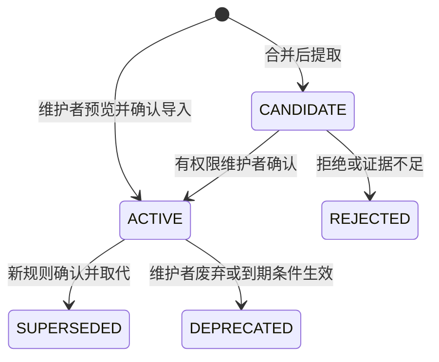

# Pi Repository Governance Agent — Memory Design

版本：v0.1｜日期：2026-09-10

> 本文定义 Team Memory 的数据模型、生命周期、作用域、检索、冲突与 Session 边界。产品目标见 [PRD-MVP.md](./PRD-MVP.md)。

## 1. Memory 的职责

Team Memory 用于保存经确认、可复用、可追溯的长期工程知识。

它不是：

- Agent 的聊天历史。
- 单次 Job 的上下文缓存。
- 任意代码事实的自动摘录。
- 模型高 confidence 输出的自动规则。

Memory Manager 是公共业务模块，负责：

- 保存。
- 检索。
- 权限与仓库边界。
- 状态流转。
- 版本管理。
- 替代与废弃。

Agent 负责理解和提出候选；服务端负责候选是否允许生效。

## 2. Memory 来源

正式候选默认由已合并 PR 触发的 Decision Extractor 产生。

维护者还可通过 [规则导入](rule-import.md) 预览 Markdown 或其他项目的生效规则，再明确确认生效。团队管理员可将 Markdown 导入团队；导入规则归属于所选项目或团队，人工导入不经过模型提取。项目规则的团队提升来源单独记为 `promotion`。

触发条件：

```text
pull_request.closed && merged=true
```

读取：

- 最终代码变更。
- PR 描述。
- Review 意见。
- 人类讨论。
- 可获得的线程状态。
- 与本次合并对应的可靠代码快照。

必须覆盖 merge、squash、rebase 等合并方式；无法还原可靠快照时标记证据不足。

不能使用“稍后默认分支 HEAD”代替该 PR 的真实合并结果。

## 3. 可提取的决策类型

- `architecture_decision`
- `engineering_rule`
- `security_rule`
- `coding_rule`
- `exception`
- `deprecated_pattern`

每条候选必须回答：

1. 决策是什么？
2. 为什么做出？
3. 哪些仓库、路径、模块、语言或条件适用？
4. 哪条人类讨论支撑它？
5. 哪个代码位置支撑它？
6. 它是通用规则、局部例外还是一次性实现选择？
7. 是否与已有规则重复、冲突或构成替代？

不提取：

- 寒暄。
- 重复意见。
- 未定论猜测。
- 仅凭当前代码形式推断出的“团队规定”。

PR 合并或线程 resolved 只能作为上下文证据，不能单独证明形成了通用团队共识。

## 4. Memory 数据模型

| 字段 | 含义 |
| --- | --- |
| id、version | 规则稳定标识与版本 |
| team_id、repository_id | 团队或项目归属，恰好一个非空；团队规则的 installation_id 为空 |
| level | must / should / info，默认 should；随版本确认生效 |
| type、title、content、rationale | 类型、标题、规则正文、决策理由 |
| scope | 仓库、路径、语言、模块、适用条件 |
| source | PR 来源（评论、提交 SHA），或导入来源（文件摘要／原项目规则版本、导入人和时间） |
| evidence | 人类讨论与代码依据，注明明确证据或推断 |
| confidence、uncertainties | 模型自评和不确定因素；人工导入的 confidence 为 null，不伪造模型评分 |
| status | CANDIDATE / ACTIVE / SUPERSEDED / DEPRECATED / REJECTED |
| exception_to、expires_at | 例外对应原规则和可选到期时间 |
| supersedes、superseded_by | 替代关系 |
| approved_by、approved_at | 生效确认者和时间 |
| created_at、updated_at | 创建和更新时间 |

示例：

```yaml
id: MEMORY-038
version: 1
team_id: null
repository_id: <repository-id>
level: should
type: coding_rule
title: Java DTO 字段不使用 Optional
content: 对外接口的 Java DTO 字段不使用 Optional 类型。
rationale: 保持序列化行为和接口表达一致。
scope:
  paths: [backend/**/dto/**]
  languages: [java]
source:
  pull_request: 382
  comment_url: <human-decision-comment-url>
  commit_sha: <verified-merged-snapshot-sha>
evidence:
  - <reviewer-explicit-decision>
  - <matching-final-code-location>
confidence: 0.92
uncertainties: []
status: CANDIDATE
exception_to: null
expires_at: null
supersedes: null
superseded_by: null
approved_by: null
approved_at: null
```

## 5. 状态流转



规则：

- 模型 confidence 再高也不能绕过 CANDIDATE → ACTIVE 的人工确认。
- 人工导入经独立预览确认后直接生效，并在同一事务记录审计；导入副本后续编辑仍需确认新版本。
- SUPERSEDED 和 DEPRECATED 记录保留用于追溯。
- 新规则激活和旧规则替代应作为一致状态更新，避免同时检索出两条互相冲突的 ACTIVE 规则。
- REJECTED 保留来源和拒绝结果，但不能作为现行团队要求。
- 编辑生效规则产生待确认版本，旧版在确认前继续检索；忽略更新后列表恢复展示原生效版本。
- 新版本号按所有历史版本递增，不重用被忽略的版本号。替代另一条规则时，也同时结束替代规则自身的旧生效版本。
- 替代与普通确认共用例外约束检查；例外不能取代其依赖的原规则。

## 6. 作用域

Memory 必须有明确 scope。

可包含：

- team。
- repository。
- path / path pattern。
- module。
- language。
- framework / technology。
- condition。
- expiration。

规则只有项目与团队两级归属，没有独立的全局或组织层级。全公司基线可由服务管理员创建一个包含相关仓库的团队。团队共享以显式仓库归属为边界，不因为文本或向量相似自动跨仓库引用。

### 6.1 团队与管理权限

`teams` 保存唯一名称、创建人和创建时间；`team_members` 以小写 GitHub login 标识成员，角色为 `admin` 或 `member`；`team_repositories` 保存团队与仓库的多对多归属，一个仓库可以加入多个团队。

`SERVICE_ADMINS` 中的服务管理员负责创建、改名、删除团队、设置仓库归属，以及增删团队管理员。团队管理员或服务管理员可以增删普通成员，管理本团队规则的编辑、确认、忽略、停用和替代，并预览、确认 Markdown 导入。普通成员只展示团队归属，不获得额外规则或仓库管理权限。

项目规则的管理仍按 GitHub 仓库 maintain / admin 权限授权。仓库维护者可以查看所属团队的生效规则、设置项目覆盖和提交提升，但不能直接编辑或批准团队规则。规则详情 API 根据规则归属授权；没有团队管理权限的仓库维护者只能读取适用团队规则的生效版本。写操作沿用登录会话与 CSRF 校验。

### 6.2 项目覆盖

`rule_overrides` 以 `(repository_id, memory_id)` 唯一标识项目对团队规则的覆盖，保存操作、级别、非空理由、操作人和时间：

- `disable`：在本项目停用，级别为空。
- `level`：将本项目级别调整为 must、should 或 info。
- 取消覆盖：必须填写取消理由，删除该项目的覆盖记录，恢复采用团队定义；同一条数据库语句将原覆盖与取消理由写入 `memory_audits` 的 `override-remove` 审计，保留责任人和时间。

覆盖只允许指向该项目所属团队的规则，不修改团队规则的正文、状态或版本。辅助 `team_id` 与仓库归属组成外键，数据库同时检查目标规则归属；仓库移出团队时，其对应覆盖立即删除，重新加入不会恢复旧覆盖。删除团队会级联删除团队规则所有版本、成员、仓库归属、导入预览与项目覆盖；项目原规则及规则审计保留，删除团队不会自动恢复已替代的项目规则。

### 6.3 项目规则提升

仓库维护者选择本项目所属的团队，将 ACTIVE 项目规则的生效版本复制为团队 CANDIDATE。副本保留正文、级别、范围和证据，来源为 `{kind: "promotion", repositoryId, memoryId, version}`；同一团队、同一来源版本重复提交不重复创建候选。创建副本记录 `promote` 审计，项目规则在团队批准前继续生效。忽略提升不改变项目规则。

团队管理员批准时，服务在同一事务中检查来源仓库仍属于该团队，来源版本仍为 ACTIVE，再将团队候选转 ACTIVE、项目原版本转 SUPERSEDED，写入双方的 `supersedes` / `superseded_by` 与 `supersede-old` / `supersede-new` 审计。来源版本已变化或仓库已移出团队时拒绝批准，保留候选供人工处理，不替代未被提升的新版。团队规则后续编辑仍采用普通候选版本流程，不重复提升原项目规则。

项目例外可以关联本项目或所属团队的生效原规则。团队例外只能关联同团队的生效规则；提升项目例外时保留原关联以便追溯，确认前须重新关联团队内生效原规则。例外仍必须限定范围，不能通过替代删除它依赖的原规则。

### 6.4 级别与上下文编译器

每条规则具有 `must`（必须）、`should`（建议）或 `info`（参考）级别。已有规则经迁移统一为 should，Markdown 导入也默认 should；跨项目导入和团队提升保留来源级别。修改生效规则的级别产生候选新版本，批准前旧级别继续有效。项目覆盖的级别独立于团队版本，不改变团队默认级别。

Review、Reply、健康检查、开发任务和规则提取统一从 `src/memory/context.ts` 取得本项目实际适用的规则。一次 SQL 收集项目和所属团队的 ACTIVE 最新版本及本项目覆盖；候选更新不替代仍有效的旧版本。纯函数先应用停用或级别覆盖（保留 `teamLevel` 原级别），再按 Scope 过滤、带出例外依赖的有效原规则，返回全文 `full`、超限索引 `index`、`mustOverBudget` 和截断前总数。被项目停用的原规则不会被例外重新带回。

项目规则与团队规则的差异通过项目例外（按路径生效）或项目覆盖停用（整个项目）表达；编译器不推断冲突。多个团队同范围的规则都保留。仓库移出团队后，后续编译不再提供该团队规则；规则页选中仓库时显示本项目停用或级别覆盖。

## 7. 例外规则

例外必须：

- 关联原规则 `exception_to`。
- 明确适用范围。
- 可选设置 `expires_at`。
- 保留来源证据。

一次 PR 中接受的例外不会取消整个团队规则。

如果存在未解决规则冲突：

- Review 应明确指出冲突。
- 展示各自来源和适用范围。
- 请求人类判断。
- 模型不能静默选择其中一条成为最终规范。

## 8. 替代与废弃

### 8.1 替代

新规则取代旧规则时：

```text
Old ACTIVE
  ↓
SUPERSEDED

New CANDIDATE
  ↓ maintainer confirm
ACTIVE
```

同时维护：

- `supersedes`
- `superseded_by`

### 8.2 废弃

规则不再使用但不存在直接替代项时，转为 DEPRECATED。

废弃后：

- 继续保留历史。
- 不参与常规 Review 的现行规则判断。
- 可以在历史解释场景中被人工查看。

## 9. 检索流程

M1 使用 PostgreSQL 保存规则、来源和生命周期。

检索顺序：

```text
授权范围
  ↓
repository / team 边界
  ↓
status = ACTIVE
  ↓
项目覆盖（停用或改级别）
  ↓
scope / path / language / module
  ↓
例外关联 → 级别、范围和内容相关性排序 → 全文与超限索引
```

Review 只允许 ACTIVE 且作用域匹配的 Memory 作为团队约定依据。

`conditions` 是自然语言条件，不参与服务端过滤，由 Agent 结合正文判断是否适用。

Review 的字符预算仍为 `REVIEW_MEMORY_CHARS`（30 000），按 `title + content + rationale` 计算。范围命中的规则和例外带出的原规则按覆盖后的级别排序：must 全部进入全文，即使自身超限也不截断，并记录日志和 limitations；剩余额度依次提供 should、info，同级别内限定范围的优先、全局的在后，再按词重叠分数和 ID 排序。保持排序前缀，第一条超限后的其余非 must 规则进入索引（仅 id、version、title、level、scope）。普通截断同样记录日志，在 limitations 说明“只带了 N/M 条”。

本批 Review 只接收 `full`，不把索引交给模型，也没有按需读全文工具。发给模型的字段为 `id`、`version`、`type`、`title`、`content`、`rationale`、`scope`、`source`、`exceptionTo`、`supersedes`、`level`。编译器的索引用于召回评测，索引覆盖率不能解释为当前 Review 已读取全文。must 超限可能增加每轮输入开销；缓存读取仍按全额计入预算。

Reply 与健康检查在不按字符截断的编译结果上，仍用 `rankMemories` 按词重叠排序取前 10 条；Reply 额外带回原意见引用的、仍在本项目有效集合内的规则。开发任务不预先按路径或字符过滤，由 `createRuleBook` 在实际读写文件时附规则，全文和目录均带有效级别。提取器使用有字符预算的全文，`existingRules` 带 `repositoryId` / `teamId` 归属：例外和冲突可关联团队规则，`supersedes` 仅允许本项目规则，其他目标按 `unknown_rule` 丢弃。

模型输出中引用的 Memory ID 和 version 必须由服务端再次校验：

- 记录存在。
- 当前用户 / Job 可见。
- 在本次编译且实际提供的清单中（项目或所属团队）；不再要求规则自己的 repository_id 等于任务仓库。
- status 仍为 ACTIVE。
- version 未过期。
- scope 仍然适用。

## 10. 存储与搜索策略

### 规则使用统计

管理页按规则 ID 汇总所有版本在数据保留期内的 PR Review 使用情况，不设额外的 30 天窗口，不计 Reply、开发任务或健康检查。Review 完成模型输出校验并保存意见时，将实际提供给模型的规则 ID 和版本记入 `review_memory_usage`；同一任务重试时，同一规则只记一次，保留首次记录的版本。`provided` 是其中不同 Review 任务数，表示已完成分析并保存结果，不以 GitHub 发布成功或任务最终状态为条件。未完成分析校验的调用不计入。

`cited` 统计 `review_findings.memory_id` 指向该规则的意见，与概览页“意见去向”采用相同口径：排除 `binding_status='pending'` 的意见和带 `presentation.repeatOf` 的重复意见；引用计意见条数，一次 Review 引用多次也分别计数。按意见当前状态，`fixed` 为 `FIXED`，`inferredFixed` 为已记录合并推断且当前状态不是 `FIXED` 的意见（与回复确认的修复分开计），`withdrawn` 为 `WITHDRAWN`，`exception` 为 `EXCEPTION_PENDING`，`open` 为 `OPEN`、`STILL_VALID`、`NEEDS_CLARIFICATION`；`lastCitedAt` 为符合上述条件的意见中最近的创建时间，无引用时为 null。例外仅表示本次意见的结局，不代表已形成生效团队规则。

没有记录时各项为 0。提供记录从本功能启用后开始积累，不推测历史召回；现存历史意见仍可计入引用，因此历史规则的引用次数可能大于提供次数。删除或按保留期清理 Review 任务时，提供记录与意见随任务删除，统计同步减少。这组数字只用于展示，不改变规则选取、排序或生命周期。

### 合并推断与规则复查

项目规则的统计限定本仓库；团队规则按规则 ID 汇总团队各仓库的使用，包括仓库维护者看到的继承规则列表。版本和任务保留期口径相同。

合并后的规则提取任务在“无人类讨论”提前结束之前执行修复推断，不调用模型：取该 PR 仍为 OPEN / STILL_VALID / NEEDS_CLARIFICATION、带路径和 RIGHT 侧行号且不带 `presentation.repeatOf` 的意见，按意见的 head SHA 到 PR 合并前最后的 head 调用 GitHub compare（不用合并提交：squash／rebase 合并的提交不以意见的 head 为祖先，行号对不上）；只有 compare 状态为 ahead（意见的 head 是祖先）才推断，强推过的不推断。该文件 patch 的旧侧行范围（纯新增按插入位置）与意见行号 ±3 行相交时，记录 `inferred_fixed_at` 与 `inferred_fixed_sha`。不改变意见状态，也不自动停用规则。compare 失败记录日志，继续规则提取；没有 patch 及 compare 未返回的文件不推断。GitHub compare 文件列表最多 300 项，因此“未推断”不能说明问题仍然存在。

管理页“需要复查”队列仅显示当前用户可管理的 ACTIVE 规则；存在候选更新时按仍生效的版本检查。原因在请求时计算，阈值集中在 `RULE_REVIEW`，没有定时任务或配置项：

- 噪声大：引用至少 3 次，当前 WITHDRAWN 占比至少 40%。
- 沉睡：当前版本生效满 90 天，最近 90 天没有被引用。
- 路径失效：`scope.paths` 非空，在所有适用仓库默认分支中均匹配不到文件。项目规则查本仓库；团队规则查团队全部仓库。只有打开队列时才按需读取 recursive Git tree，按仓库缓存 24 小时。截断、无访问权限或读取失败的仓库不作失效依据，页面列出未检查仓库；团队任一仓库未能完整检查时，不判定该规则路径失效。团队没有仓库时也不判定。
- 到期：`expires_at` 已到，不自动修改规则状态。

`GET /api/rule-review` 返回复查规则、原因与依据数字；`POST /api/memories/:id/dismiss-review` 接受 `{reason, note}`，理由必填，沿用规则编辑的登录、CSRF 和项目维护者／团队管理员权限。暂不处理按规则 ID 与原因保存操作人、理由、时间，90 天内不再显示这一原因，即使依据变化；其他原因仍显示，到期后按当时依据重新计算。

### 搜索策略

M1：

- PostgreSQL。
- 普通关系字段表达替代与例外关系。
- 先做作用域过滤和文本检索。

可选后续：

- pgvector 语义召回。

启用 pgvector 的条件：固定评测样本证明文本检索召回不足。

当前不引入：

- GraphDB。
- 独立 VectorDB。
- 独立 BM25 服务。

## 11. Session 与 Team Memory 边界

| Pi Session | Team Memory |
| --- | --- |
| 一次任务中的对话、工具调用和输出 | 经确认的长期工程知识 |
| 随 Job 建立并按需过期 | 按规则生命周期保存 |
| 用于执行、复核和排障 | 用于后续任务检索和引用 |
| 不同事件默认不共享可变上下文 | 不同任务可访问有权限的共同知识 |

同一个 PR 的后续事件也创建新的 Job，通过数据库中的：

- 原 finding。
- 线程历史。
- 最新代码。
- 当前 Memory。

重新构建上下文。

系统不依赖永久存活的聊天 Session。

## 12. 与 Reply Handler 的关系

M2 中，Reply Handler 处理人类对本 App 行内审查线程的回复。

可能产生：

- 原问题已修复。
- 原审查误判。
- 解释成立，属于有限例外。
- 解释与实现不一致。
- 证据不足。

“接受这次解释”只影响当前 finding，不自动修改 ACTIVE 团队规则。

PR 合并后仍由 Decision Extractor 读取最终代码与讨论，再提出 Memory 候选。

## 13. Memory 验收

| 场景 | 通过条件 |
| --- | --- |
| 明确 DTO Optional 决策的 PR 合并 | 生成 CANDIDATE，包含来源、代码证据、作用域和理由 |
| 维护者确认候选 | Memory 转 ACTIVE，并记录确认者和时间 |
| 后续相关 PR 再次违反 | 成功召回并引用该 ACTIVE Memory |
| 规则被替代 / 废弃 / 拒绝 | 不再作为现行团队要求 |
| 类似代码出现在不相关模块 | 不误召回该规则 |
| 其他仓库存在语义类似规则 | 默认不跨仓库引用 |
| 同一来源重复提取 | 不重复新增相同规则 |
| 没有可复用决策 | 允许 DecisionProposal[] 为空 |
